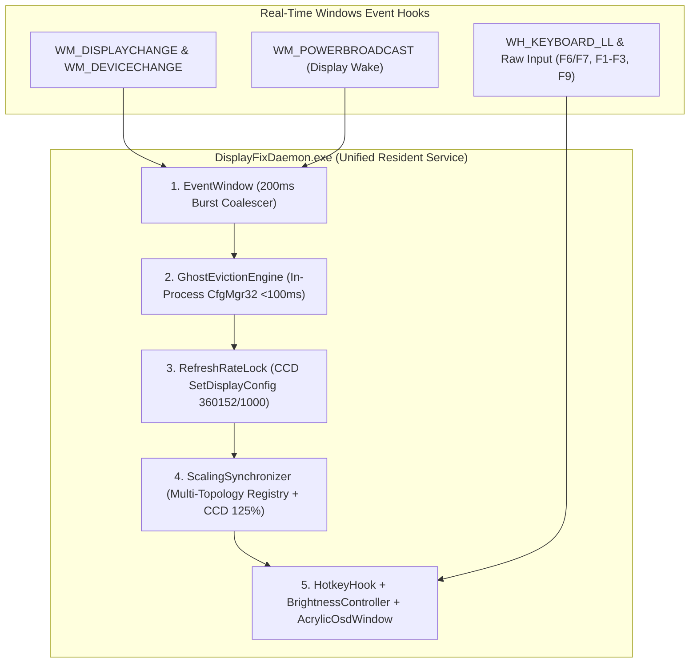

<p align="center">
  
</p>

<p align="center">
  
  
  
  
  
  
</p>

<p align="center">
  <b>Unified event-driven resident daemon that eliminates Advanced Optimus display lag, locks 360Hz &amp; 125% DPI scaling, and restores F6/F7 brightness hotkeys with a Windows 11 Acrylic OSD.</b><br>
  Built and measured on a Dell G15 5530 · Service Tag CYFY434 · System SKU 0BF7 · BIOS 1.36.0
</p>

---

## The Problem

On the Dell G15 5530 (Intel Core i7-13650HX + NVIDIA GeForce RTX 4060 Laptop GPU + AU Optronics `AUO AA9F` 1080p 360Hz panel), using **Advanced Optimus** (Dynamic Display Switching / DDS) triggers four interacting hardware/firmware/OS defects:

1. **Ghost Monitor & DWM V-Sync Starvation (31–54% CPU Stall)**: When the hardware eDP mux switches the panel to the RTX 4060 (`UID4353`), the Intel UHD monitor instance (`UID8388688`) is left behind as an active display. `dwm.exe` composites a phantom swapchain for the unclocked pipe, burning **31–54% of a CPU core at desktop idle** and stalling mouse/keyboard input for ~1 second at a time.
2. **Dead F6 / F7 Brightness Keys & 0% Black-Screen Trap**: Evicting the stale Intel monitor removes `WmiMonitorBrightnessMethods`. Dell's ACPI brightness keys (`F6` / `F7`) go dead, and `root\wmi:NvWmiBrightness` requires elevation, exhibits an `-8` quantization offset, and turns the eDP backlight completely off (`0%` black screen) if unguarded.
3. **125% -> 100% Display Scaling Desynchronization**: Windows initializes the NVIDIA topology registry key (`PerMonitorSettings\AUOAA9F0_..._10DE_28E0_...`) with `DpiValue = 4294967295` (`-1`), dropping display scaling from **125%** (`120 DPI`) to **100%** (`96 DPI`) on every mux switch and causing blurry Win32 fonts.
4. **360Hz Refresh Rate Resets**: Display adapter transitions and sleep/wake cycles can drop the panel from its native `360.152Hz` (`360152 / 1000`) down to `60Hz`.

| Display Mode | Monitor Devices | `dwm.exe` Idle CPU | Refresh Rate | DPI Scaling | F6/F7 Brightness |
|---|---|---|---|---|---|
| Optimus (panel on iGPU) | 1 | 1–3 % | 360 Hz | 125 % | Works |
| **Advanced Optimus (unpatched)** | **2 (Ghost)** | **31–54 % (Stalls)** | **Resets to 60 Hz** | **Drops to 100 %** | **Dead** |
| **Advanced Optimus + `DisplayFixDaemon.exe` v2.0** | **1 (`< 100ms` eviction)** | **0.8–1.8 %** | **Locked 360.152 Hz** | **Locked 125 %** | **Active + Acrylic OSD** |

> Detailed root-cause evidence and architectural specification:
> - **[docs/architecture.md](docs/architecture.md)** — Full 6-component system architecture & hardware root-cause analysis
> - **[docs/verification_guide.md](docs/verification_guide.md)** — Step-by-step physical & automated verification guide
> - **[docs/problem.md](docs/problem.md)** — Original hardware telemetry & defect measurements

---

## The v2.0 Solution: `DisplayFixDaemon.exe`

Version 2.0 unifies the legacy polling tools (`PhantomGuard.exe` and `NvBrightness.exe`) into a single, zero-dependency C# resident daemon (`DisplayFixDaemon.exe`) running at `RunLevel: HighestAvailable` with `PerMonitorV2` DPI awareness.



### Six Core Subsystems (Features F01–F16)

1. **Zero-Lag Event Dispatcher (`src/Daemon/EventWindow.cs` — F05)**: Captures `WM_DISPLAYCHANGE`, `WM_DEVICECHANGE` (`GUID_DEVINTERFACE_MONITOR`, `GUID_DEVINTERFACE_DISPLAY_ADAPTER`), and `WM_POWERBROADCAST` (`GUID_CONSOLE_DISPLAY_STATE`) with `< 100ms` latency and a `200ms` burst debounce window (replacing the legacy 16–30s polling loop).
2. **Sub-Second In-Process Ghost Eviction (`src/Daemon/GhostEvictionEngine.cs` — F04)**: Recycles only the stale Intel monitor devnode (`UID8388688`) in-process via native `CfgMgr32` (`CM_Disable_DevNode` / `CM_Enable_DevNode`) in `< 100ms`—no `pnputil.exe` child processes, no full-GPU adapter toggle, and zero game alt-tabs. Never acts when an external monitor is connected.
3. **Native 360Hz Refresh Rate Lock (`src/Daemon/RefreshRateLock.cs` — F07)**: Enforces the exact native rational `360152 / 1000` (`360.152Hz`) via Windows CCD `SetDisplayConfig` (`SDC_APPLY | SDC_USE_SUPPLIED_DISPLAY_CONFIG | SDC_SAVE_TO_DATABASE | SDC_ALLOW_CHANGES`).
4. **Persistent 125% DPI Scaling Engine (`src/Daemon/ScalingSynchronizer.cs` — F08, F09)**: Synchronizes `HKCU\Control Panel\Desktop\PerMonitorSettings\*AUOAA9F*` (`DpiValue = 0`, `LogPixels = 120`) across both Intel (`8086_A78B`) and NVIDIA (`10DE_28E0`) topologies and invokes `DisplayConfigSetDeviceInfo` (`DISPLAYCONFIG_DEVICE_INFO_SET_DPI_SCALE`, `scaleRel = 0`) for crisp, non-blurry 125% scaling without logoff or reboot.
5. **F6/F7 Brightness Engine, Media Key Preservation & Acrylic OSD (`src/Brightness/` — F10–F14)**:
   - Low-level keyboard hook (`WH_KEYBOARD_LL`) + Raw Input (`HID 0x0C:0x006F/0x0070`) intercepts bare `F6` (`-5%`) and `F7` (`+5%`) in Function Key mode (`Fn + Esc`) while passing `Ctrl`/`Alt`/`Shift` + `F6`/`F7` through to apps.
   - Dual WMI backend routes to `root\wmi:NvWmiBrightness` (with `+8` offset calibration and a hard `10%` floor) in NVIDIA mode or `WmiMonitorBrightnessMethods` in Optimus mode, preserving user brightness across mux transitions.
   - Preserves function-row media keys (`F1` Mute, `F2` Vol-, `F3` Vol+, `F9` Play/Pause) via 64-bit `SendInput`.
   - Renders a non-activating Windows 11 Acrylic OSD overlay (`WS_EX_NOACTIVATE | WS_EX_TRANSPARENT | WS_EX_TOPMOST | WS_EX_LAYERED`) that auto-dismisses after `1.5s` and never steals focus from full-screen games.
6. **Telemetry, Stress Harness & 136-Test E2E Suite (`scripts/` & `tests/e2e/` — F01–F03, F15–F16)**: Live system telemetry prober (`probe_system.ps1`), DWM stability monitor (`dwm_health.ps1`), 100-switch stress harness (`stress_test.ps1`), master acceptance runner (`scripts/verify.ps1`), and a 29-suite (`136/136` passing) E2E test harness.

---

## Quick Start: Build, Install & Verify

Run from an **elevated PowerShell prompt** (`Run as Administrator`):

```powershell
git clone https://github.com/morshedmilton/dell-g15-displayfix.git
cd dell-g15-displayfix

# 1. Compile DisplayFixDaemon.exe using the built-in Windows .NET 4.8 csc.exe compiler
powershell -ExecutionPolicy Bypass -File .\build.ps1

# 2. Install to C:\ProgramData\DisplayFix and register the elevated logon scheduled task
powershell -ExecutionPolicy Bypass -File .\install.ps1

# 3. Run the master acceptance verification suite (Deliverables + CLI + Telemetry + DWM + Stress + 136 E2E Tests)
powershell -ExecutionPolicy Bypass -File .\scripts\verify.ps1 -Quick
```

**Uninstall** — cleanly stops the daemon, unregisters scheduled tasks, and removes `C:\ProgramData\DisplayFix`:

```powershell
powershell -ExecutionPolicy Bypass -File .\uninstall.ps1
```

---

## Using It & CLI Reference

### Keyboard Controls (Function Key Mode: `Fn + Esc`)

| Key | Action | Backend / Mechanism |
|---|---|---|
| **F6 / F7** | Brightness `-5%` / `+5%` (clamped `10%–100%`) | `NvWmiBrightness` (+8 offset) or `WmiMonitorBrightnessMethods` + Acrylic OSD |
| **F1 / F2 / F3** | Audio Mute / Volume Down / Volume Up | 64-bit `SendInput` (`VK_VOLUME_MUTE` / `DOWN` / `UP`) |
| **F9** | Media Play / Pause | 64-bit `SendInput` (`VK_MEDIA_PLAY_PAUSE`) |
| **Ctrl / Alt / Shift + F6/F7** | Passed untouched to foreground application | Bypassed in `WH_KEYBOARD_LL` |

### `DisplayFixDaemon.exe` Command-Line Interface

```powershell
.\bin\DisplayFixDaemon.exe --status                # Live mutex, PID, refresh rate, DPI scale, and brightness telemetry
.\bin\DisplayFixDaemon.exe --evict-now             # Immediate one-shot ghost monitor eviction (<100ms)
.\bin\DisplayFixDaemon.exe --lock-360hz            # Immediate one-shot 360.152Hz (360152/1000) CCD lock
.\bin\DisplayFixDaemon.exe --sync-dpi              # Synchronize PerMonitorSettings registry & enforce 125% CCD DPI
.\bin\DisplayFixDaemon.exe --brightness-get        # Query active WMI brightness backend and current percentage
.\bin\DisplayFixDaemon.exe --brightness-set 75     # Set panel brightness (clamped 10..100%) and show Acrylic OSD
.\bin\DisplayFixDaemon.exe --brightness-up         # Step brightness +5% and show Acrylic OSD
.\bin\DisplayFixDaemon.exe --brightness-down       # Step brightness -5% and show Acrylic OSD
.\bin\DisplayFixDaemon.exe --test-osd 65           # Render non-activating Acrylic OSD and verify focus retention
```

---

## Repository Layout

```
dell-g15-displayfix/
├── src/
│   ├── Daemon/
│   │   ├── Program.cs                  # Main entry point, single-instance mutex, CLI & service loop
│   │   ├── EventWindow.cs              # Hidden message pump (WM_DISPLAYCHANGE, WM_DEVICECHANGE, 200ms debounce)
│   │   ├── GhostEvictionEngine.cs      # In-process CfgMgr32 / SetupAPI ghost monitor eviction (<100ms)
│   │   ├── RefreshRateLock.cs          # CCD SetDisplayConfig 360.152Hz (360152/1000) enforcement
│   │   ├── ScalingSynchronizer.cs      # Multi-topology PerMonitorSettings sync & CCD 125% DPI lock
│   │   └── Interop.cs                  # Win32, CCD, CfgMgr32, SetupAPI, DWM, and User32 P/Invoke definitions
│   └── Brightness/
│       ├── HotkeyHook.cs               # WH_KEYBOARD_LL + Raw Input hook for F6/F7 & F1-F3/F9 preservation
│       ├── BrightnessController.cs     # Dual WMI backend (NvWmiBrightness +8 offset & WmiMonitorBrightness)
│       └── AcrylicOsdWindow.cs         # Non-activating Win32/DWM Acrylic OSD pill overlay
├── scripts/
│   ├── build.ps1                       # Native .NET 4.8 csc.exe compiler script
│   ├── install.ps1                     # Deploys binary & registers elevated DisplayFixDaemon logon task
│   ├── uninstall.ps1                   # Stops daemon, unregisters tasks, cleans C:\ProgramData\DisplayFix
│   ├── verify.ps1                      # Master 6-phase acceptance validation runner
│   └── diagnostics/
│       ├── probe_system.ps1            # Live GPU, CCD, PnP, DPI, and DWM telemetry snapshot (F01)
│       ├── dwm_health.ps1              # DWM working set, handles, GDI/USER objects, Event IDs 1000/4101 (F02)
│       └── stress_test.ps1             # 100-switch stress harness with OLS regression leak analysis (F03)
├── tests/e2e/
│   ├── test_runner.ps1                 # Master E2E test harness (29 suites, 136 tests across Tiers 1-4)
│   ├── tier1_features/                 # Tier 1: Feature isolation tests (F01-F16, 80 tests)
│   ├── tier2_boundaries/               # Tier 2: Boundary & corner cases (B01-B04, 20 tests)
│   ├── tier3_combinations/             # Tier 3: Pairwise feature combinations (C01-C05, 20 tests)
│   ├── tier4_scenarios/                # Tier 4: Real-world gaming, sleep/wake, HDMI, video workloads (16 tests)
│   └── tier5_adversarial/              # Tier 5: Adversarial hardening suites
├── docs/
│   ├── verification_guide.md           # Step-by-step physical & automated verification guide (F15)
│   ├── architecture.md                 # System architecture & root-cause analysis
│   └── problem.md                      # Empirical hardware measurements on Dell G15 5530
└── bin/
    └── DisplayFixDaemon.exe            # Compiled standalone x64 executable
```

---

## Changelog & License

- See **[CHANGELOG.md](CHANGELOG.md)** for full release history (`v1.0.0` through `v2.0.0`).
- See **[TEST_READY.md](TEST_READY.md)** and **[TEST_INFRA.md](TEST_INFRA.md)** for E2E test suite certification.
- Licensed under the **MIT License** — see [LICENSE](LICENSE).
