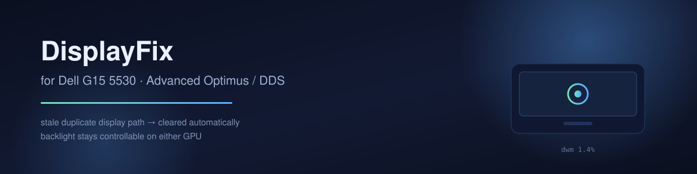
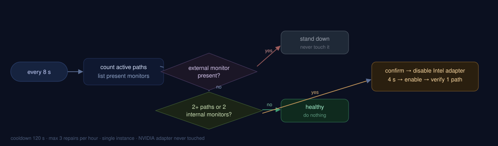
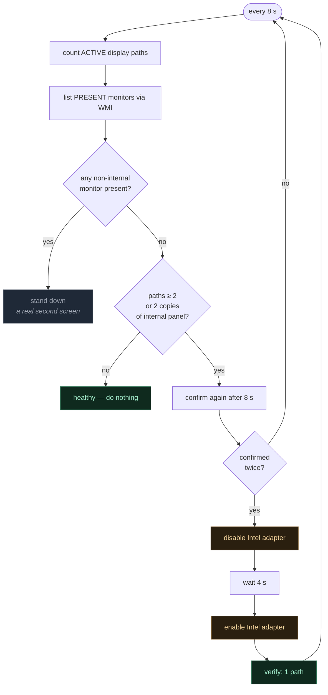
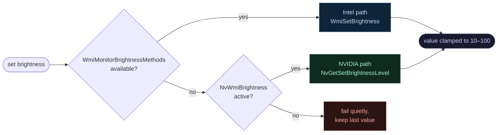

<p align="center">
  
</p>

<p align="center">
  
  
  
  
  
</p>

<p align="center">
  <b>Two tiny tools that keep a hybrid-graphics laptop usable after its display muxes to the dGPU.</b><br>
  Built and measured on a Dell G15 5530 · Service Tag CYFY434 · BIOS 1.36.0
</p>

---

## The problem

On this machine, using **Advanced Optimus** (Dynamic Display Switching) as designed leaves Windows with **two monitor devices for one physical panel**.

While that duplicate exists, `dwm.exe` holds **31–54 % of a CPU core**. Input stalls for about a second at a time, and game frame pacing collapses.

Measured, same machine, seconds apart:

| Display mode | Monitor devices | `dwm` CPU |
|---|---|---|
| Optimus (panel on iGPU) | 1 | 1–3 % |
| **Advanced Optimus (panel on dGPU)** | **2** | **31–54 %** |
| Advanced Optimus, duplicate cleared | 1 | **1.4 %** |

The catch that makes it vicious: **the duplicate device is also the only provider of `WmiMonitorBrightness`.** Clear it and brightness control disappears entirely — no slider, and the Fn keys go dead.

So the user is forced to pick: use the feature and lose input, or fix the input and lose the backlight.

> Full analysis, reproduction steps and registry evidence: **[docs/problem.md](docs/problem.md)**

---

## The solution

Two independent tools, each solving one half of that trap.

### 1 · PhantomGuard — removes the duplicate

<p align="center">
  
</p>



**Safety rails.** Every one of these exists because a wrong repair costs the user their display:

| Rail | Value | Why |
|---|---|---|
| Confirmations before acting | 2 | never reacts to a transient enumeration |
| Minimum gap between repairs | 60 s | prevents thrash if the state flaps |
| Attempts per switch | 3 | a repair that cannot work stops instead of looping |
| Hourly cap | **none** | every display switch is its own episode, so switching often is fine |
| External monitor present | never acts | would otherwise blink a real screen |
| NVIDIA adapter | never touched | only the Intel side is toggled |
| Single instance | mutex | two guards cannot fight |
| Every decision | logged | `C:\ProgramData\DisplayFix\logs\guard.log` |

**How the limit works now.** An *episode* opens when a duplicate appears and closes when the
display state is clean again. Each switch is a fresh episode with a fresh budget of three
attempts, so there is no hourly ceiling to run into. The three-attempt cap exists only so
that a duplicate the repair cannot clear does not turn into an endless disable/enable loop;
it is reset the moment the display state comes back clean.

### 2 · NvBrightness — puts the backlight back under control

The Windows brightness API disappears with the Intel provider, but the panel's backlight is still reachable through NVIDIA's own WMI interface. This tool picks whichever backend is alive, on every single operation.



Because the backend is re-detected per call, the tool survives a display-mode switch without a restart.

**Hard floor at 10 %.** On this panel 0 is indistinguishable from display-off — the screen goes black and looks dead. So:

- the slider range is **10–100**
- every write is clamped
- if the tool starts and finds the panel below 10, it **lifts it immediately** (safety rescue)

---

## Install

```powershell
# from an elevated prompt
git clone https://github.com/morshedmilton/dell-g15-displayfix.git
cd dell-g15-displayfix
.\build.ps1          # compiles with the csc.exe that ships with Windows
.\install.ps1        # copies to ProgramData, registers the task + startup entry
```

No SDK, no runtime install, no dependencies. `build.ps1` uses
`C:\Windows\Microsoft.NET\Framework64\v4.0.30319\csc.exe`.

**Uninstall** — the same script that undoes everything:

```powershell
.\uninstall.ps1      # elevated
```

---

## Where it lives

```
C:\ProgramData\DisplayFix\
  PhantomGuard.exe          scheduled task "DisplayFixGuard"      (logon, highest privileges)
  NvBrightness.exe          scheduled task "DisplayFixBrightness" (logon, highest privileges)
  hotkeys.ini               which function-row keys are claimed, and what they do
  logs\guard.log            duplicate-path decisions, rolling 1 MB
  logs\app.log              which keys were bound at startup
```

Both run as scheduled tasks with `RunLevel Highest`, so neither asks for UAC at logon.
That is not laziness: the guard must disable and re-enable a device, and the NVIDIA
brightness WMI provider refuses access to a non-elevated caller once the panel has muxed
to the dGPU. A per-user `Run` entry looked tidier and silently broke brightness — that
was the 1.0.0 bug fixed in 1.0.1.

---

## Using it

| Action | Result |
|---|---|
| **F6 / F7** | brightness −5 % / +5 % |
| **F1 / F2 / F3** | mute / volume down / volume up |
| **F9** | play-pause |
| **Left-click** the tray icon | brightness slider |
| **Ctrl + Alt + ↑ / ↓** | +5 % / −5 % |
| **Right-click** the tray icon | presets 100/75/50/25/15, exit |

The function row is configurable — see **hotkeys.ini** below.

The tooltip shows the live state, for example `Brightness 45% (NVIDIA)`.

---

## Verify it is working

```powershell
# one-shot scan, prints its reasoning to the log
& 'C:\ProgramData\DisplayFix\PhantomGuard.exe' --once

Get-Content 'C:\ProgramData\DisplayFix\logs\guard.log' -Tail 20
```

A healthy machine logs nothing in the background, by design. When it acts, the log
reads like this:

```
01:12:04  duplicate internal path detected (1/2) 2 path(s); present: AUOAA9F/4&3A9F8B26&8&UID8388688 AUOAA9F/5&39808DAE&2&UID4353
01:12:12  duplicate internal path detected (2/2) ...
01:12:12  REPAIR starting
01:12:12    adapter: PCI\VEN_8086&DEV_A78B&SUBSYS_0BF71028&REV_04\3&11583659&0&10
01:12:16    pnputil /disable-device -> exit 0
01:12:27    pnputil /enable-device -> exit 0
01:12:34  REPAIR done - active paths now 1
```

---

## Honest limits

| Thing | Status |
|---|---|
| Fixes Dell's underlying defect | **No.** It is worked around, not repaired. The bug lives in the BIOS/NVPCF layer. |
| Fn brightness keys | **Do not work** while the panel is on the dGPU. Dell's ACPI hotkey path ends at the Intel provider. |
| Windows brightness slider | **Absent** while the panel is on the dGPU. Returns by itself in Optimus. |
| Moment of repair | Intel adapter is toggled once — the screen may blink for about half a second, and a fullscreen game may alt-tab once. Triggered ~16 s after the mux, i.e. during loading, not mid-fight. |
| G-Sync and colour | Untouched. Whatever NVIDIA Control Panel has set stays set. |

---

## Repo layout

```
src\            C# sources — no external packages
bin\            prebuilt executables (also attached to each Release)
assets\         hero + flow diagrams
docs\           problem analysis, design notes
build.ps1       compile
install.ps1     deploy
uninstall.ps1   remove every trace
CHANGELOG.md
```

---

## Changelog

See **[CHANGELOG.md](CHANGELOG.md)**. Every patch ships as its own tagged release
with the rebuilt executables attached.

## License

MIT — see [LICENSE](LICENSE).
