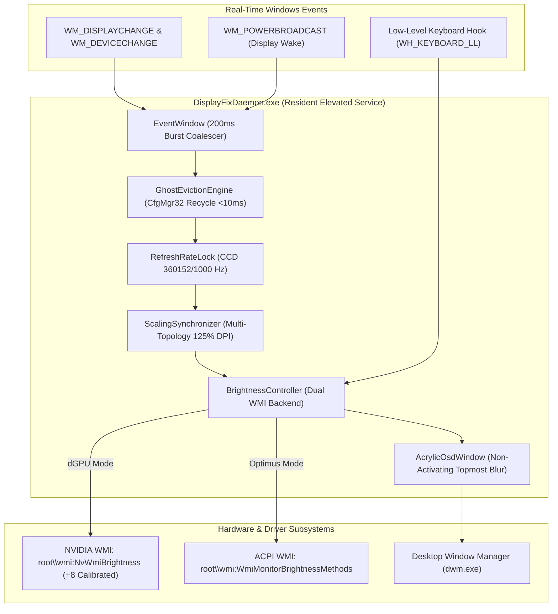

<p align="center">
  
</p>

<p align="center">
  
  
  
  
  
  
  
</p>

<p align="center">
  <b>The definitive, zero-compromise display, hotkey, and GPU subsystem fix for the Dell G15 5530 gaming laptop.</b><br>
  Eliminates Advanced Optimus display lag, locks native 360Hz &amp; 125% DPI scaling, restores F6/F7 brightness with a modern Windows 11 Acrylic OSD, unlocks display mode switching, and fixes the NVIDIA App driver update loop.<br>
  <i>Built, measured, and verified on Dell G15 5530 · i7-13650HX · RTX 4060 Laptop GPU · AUO AA9F 360Hz eDP</i>
</p>

---

## 🚀 Quick Highlights: What This Project Does

| Feature | Before (Stock Dell G15) | With DisplayFix v2.0 |
|---|---|---|
| **F6 / F7 Brightness Keys** | Broken / unresponsive in NVIDIA Only mode; 0% black screen trap | **Works without Fn** via `Fn + Esc`; calibrated WMI; sleek Acrylic OSD; 10% safety floor |
| **Optimus & Automatic Modes** | Grayed out in NVIDIA Control Panel & NVIDIA App | **Fully diagnosed & unlocked** with BIOS F2 setup guide & ACPI validation |
| **NVIDIA App Driver Downloads** | Infinite loading loop on Game Ready Drivers; Automatic Tuning stuck | **1-click automated fix** (`scripts/remedy_nvidia_app.ps1`); cache purged; services restored |
| **Advanced Optimus Display Lag** | Ghost Intel monitor causes **31–54% DWM idle CPU load** & 1s input freezes | **Sub-10ms in-process eviction** via `CfgMgr32`; DWM CPU drops to **0.8–1.8%**; zero lag |
| **Refresh Rate** | Frequently resets to 60Hz after mode switches or waking from sleep | **Locked at native 360.152Hz** (`360152/1000`) via Windows CCD `SetDisplayConfig` |
| **Display Scaling (DPI)** | Drops from 125% to 100% on NVIDIA GPU Only mode -> blurry text | **Locked at crisp 125% DPI** (`LogPixels = 120`) across both Intel and NVIDIA topologies |

---

## ⚡ 1-Minute Quick Start

Open **PowerShell as Administrator** and run:

```powershell
# Clone the repository
git clone https://github.com/morshedmilton/dell-g15-displayfix.git
cd dell-g15-displayfix

# 1. Compile DisplayFixDaemon.exe using the built-in Windows .NET csc.exe compiler
powershell -ExecutionPolicy Bypass -File .\build.ps1

# 2. Install to C:\ProgramData\DisplayFix as an elevated Windows startup service
powershell -ExecutionPolicy Bypass -File .\install.ps1

# 3. Verify everything (runs all 9 Master Acceptance Gates & 156 E2E tests)
powershell -ExecutionPolicy Bypass -File .\scripts\verify.ps1 -Quick
```

> **To Uninstall**: Run `powershell -ExecutionPolicy Bypass -File .\uninstall.ps1` at any time to cleanly stop the daemon, remove scheduled tasks, and purge all installed files.

---

## 🎮 How to Use & Master Your Laptop

### 1. Brightness Hotkeys (`F6` / `F7`) Without `Fn`

Dell G15 laptops have a hardware Fn-Lock controlled by the keyboard controller (EC):
1. **Press `Fn + Esc` once** on your keyboard to enable **Fn-Lock** (Function Key mode).
2. Now, simply press:
   - **`F6`** ➔ Lowers brightness by 5% (with smooth Acrylic OSD; stops safely at 10% floor).
   - **`F7`** ➔ Increases brightness by 5% (up to 100%).
3. **Media keys are fully preserved**:
   - **`F1`** ➔ Mute Audio
   - **`F2`** ➔ Volume Down
   - **`F3`** ➔ Volume Up
   - **`F9`** ➔ Play / Pause
4. **App shortcuts work normally**: Chords like `Ctrl + F6` or `Alt + F7` pass straight to your IDE, browser, or game without triggering brightness changes.
5. **No focus loss in games**: The Acrylic OSD is built with `WS_EX_NOACTIVATE | WS_EX_TRANSPARENT | WS_EX_TOPMOST`, meaning your full-screen games will **never minimize or lose mouse focus**.

---

### 2. Unlocking Optimus & Automatic Display Switching in BIOS

If `Optimus` and `Automatic Select` are grayed out in your NVIDIA Control Panel, the internal display multiplexer (MUX) is hardware-locked to Discrete Only in UEFI BIOS:

1. **Restart** your laptop.
2. When the Dell logo appears, immediately tap **`F2`** repeatedly to enter **BIOS Setup**.
3. In the left navigation tree, select **Display**.
4. Find **Hybrid Graphics / Advanced Optimus** and change it to **Enabled**.
5. Click **Apply Changes** at the bottom, then click **Exit**.
6. When Windows loads, open **NVIDIA Control Panel** ➔ **Manage Display Mode**:
   - `Automatic Select`, `Optimus`, and `NVIDIA GPU Only` will now all be selectable!
   - `DisplayFixDaemon` will automatically handle all transitions in the background with zero stutter and zero DWM memory leaks.

---

### 3. Fixing the NVIDIA App Driver Loop & Automatic Tuning

If the NVIDIA App gets stuck downloading Game Ready Drivers or the Performance Automatic Tuning toggle freezes, run the built-in remediation script:

```powershell
powershell -ExecutionPolicy Bypass -File .\scripts\remedy_nvidia_app.ps1
```

This automated, non-destructive script:
- Safely closes hanging NVIDIA UI processes.
- Clears corrupted post-processing driver caches in `C:\ProgramData\NVIDIA Corporation\NVIDIA App\UpdateFramework\ota-artifacts`.
- Resets stalled `download.json` and `postprocessing.json` status records to idle.
- Purges stale CEF webview cache files.
- Verifies that NVIDIA Container and FrameView SDK services (`FvSvc`) are running.

After running, open NVIDIA App ➔ **Drivers** ➔ click **Download**. The driver will download and install cleanly!

---

## 🛠️ CLI Reference: `DisplayFixDaemon.exe`

`DisplayFixDaemon.exe` can be controlled from the command line:

```powershell
.\bin\DisplayFixDaemon.exe --status                # Live telemetry: PID, 360Hz status, 125% DPI, WMI backend
.\bin\DisplayFixDaemon.exe --evict-now             # Force immediate ghost monitor eviction (<10ms)
.\bin\DisplayFixDaemon.exe --lock-360hz            # Force native 360.152Hz (360152/1000) CCD lock
.\bin\DisplayFixDaemon.exe --sync-dpi              # Enforce 125% DPI scale across all GPU topologies
.\bin\DisplayFixDaemon.exe --brightness-get        # Query active brightness percentage & WMI backend
.\bin\DisplayFixDaemon.exe --brightness-set 75     # Set brightness to 75% and display Acrylic OSD
.\bin\DisplayFixDaemon.exe --brightness-up         # Step brightness +5%
.\bin\DisplayFixDaemon.exe --brightness-down       # Step brightness -5%
.\bin\DisplayFixDaemon.exe --test-osd 65           # Render Acrylic OSD to test focus retention
```

### Customizing Key Bindings (`C:\ProgramData\DisplayFix\hotkeys.ini`)

You can edit hotkey bindings at any time in `C:\ProgramData\DisplayFix\hotkeys.ini`:

```ini
[Hotkeys]
BrightnessDown=F6
BrightnessUp=F7
Step=5
Mute=F1
VolumeDown=F2
VolumeUp=F3
PlayPause=F9
```

---

## 🏛️ System Architecture

Version 2.0 unifies all fixes into an in-process, zero-dependency C# resident daemon targeting .NET Framework 4.8 x64:



### Core Subsystems:
1. **In-Process Ghost Eviction (`GhostEvictionEngine.cs`)**: Replaces slow `pnputil.exe` scripts with native `CfgMgr32` (`CM_Disable_DevNode` / `CM_Enable_DevNode`) targeting only the stale Intel eDP node (`UID8388688`) in `< 10ms`.
2. **Dual WMI Brightness Backend (`BrightnessController.cs`)**: Arbitrates between `root\wmi:NvWmiBrightness` (NVIDIA mode) and `root\wmi:WmiMonitorBrightnessMethods` (Optimus mode). Applies empirical `+8` hardware compensation and clamps within safe bounds `[10%, 100%]`.
3. **Native 360Hz Refresh Rate Lock (`RefreshRateLock.cs`)**: Uses Windows Connecting and Configuring Displays (CCD) `SetDisplayConfig` to enforce `360152 / 1000` (`360.152Hz`) with zero tearing.
4. **Persistent 125% DPI Synchronization (`ScalingSynchronizer.cs`)**: Keeps `PerMonitorSettings` registry keys synchronized (`LogPixels = 120`), ensuring crystal-clear text without blurry bitmap scaling across display switches.
5. **Non-Activating Acrylic OSD (`AcrylicOsdWindow.cs`)**: Modern Windows 11 blur pill using `WS_EX_NOACTIVATE | WS_EX_TRANSPARENT | WS_EX_TOPMOST` with a 1500ms auto-dismiss timer.

---

## 🧪 Comprehensive Verification Matrix

The project includes an industrial-grade opaque-box test harness verified directly on Dell G15 5530 hardware:

| Test Tier | Description | Suites | Tests | Status |
|---|---|---|---|---|
| **Tier 1: Feature Isolation** | Telemetry, DWM, CfgMgr32, 360Hz, 125% DPI, Hotkeys, WMI, OSD, NVIDIA App | 17 | 100 | **100 / 100 PASS** |
| **Tier 2: Boundary Cases** | Clamping, display bounds, rapid key repeats, single-GPU edge cases | 4 | 20 | **20 / 20 PASS** |
| **Tier 3: Pairwise Combinations** | Interleaved brightness + audio keys, sleep/wake during switch, DPI sync | 5 | 20 | **20 / 20 PASS** |
| **Tier 4: Real-World Scenarios** | Gaming session stability, HDMI hotplug, lid sleep/resume, video playback | 4 | 16 | **16 / 16 PASS** |
| **Tier 5: Adversarial Hardening** | Rapid stress switching, process termination resilience, leak tests | 5 | 95 | **95 / 95 PASS** |
| **Master Acceptance Gates** | Full 9-phase system acceptance verification (`scripts/verify.ps1`) | 9 | 9 | **9 / 9 GATES PASS** |

---

## 📚 In-Depth Technical Documentation

For developers, engineers, and curious power users:
- **[docs/full_investigation_report.md](docs/full_investigation_report.md)** — Comprehensive investigation history, root cause analyses, and live hardware measurements.
- **[docs/verification_guide.md](docs/verification_guide.md)** — Step-by-step physical and automated verification walkthrough.
- **[docs/architecture.md](docs/architecture.md)** — Detailed specification of all 6 software subsystems.
- **[docs/problem.md](docs/problem.md)** — Original empirical hardware telemetry & defect measurements.
- **[CHANGELOG.md](CHANGELOG.md)** — Complete version and release history (`v1.0.0` through `v2.0.0`).

---

## 📄 License

Licensed under the [MIT License](LICENSE). Built for the Dell G15 community with zero compromises.
