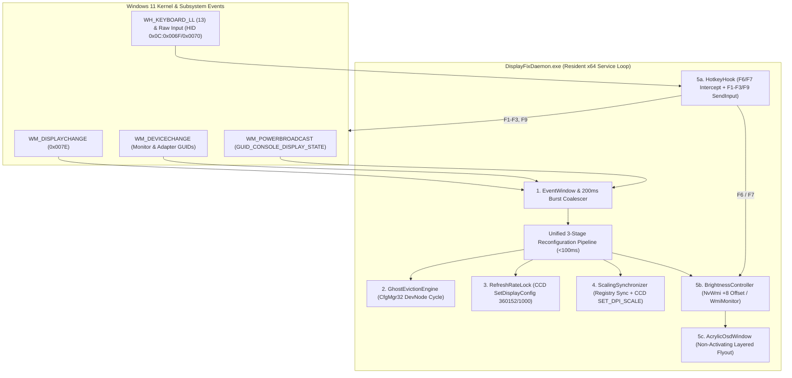

# Dell G15 5530 DisplayFix — System Architecture & Root-Cause Engineering Analysis

**Target Platform:** Dell G15 5530 (`System SKU 0BF7` · BIOS `1.36.0`)  
**Hybrid Graphics Topology:** Intel Core i7-13650HX (`PCI\VEN_8086&DEV_A78B`) + NVIDIA GeForce RTX 4060 Laptop GPU (`PCI\VEN_10DE&DEV_28E0`)  
**Internal eDP Panel:** AU Optronics `AUO AA9F` (`1920×1080` @ `360.152Hz`, Hardware ID `MONITOR\AUOAA9F`)  
**Runtime Stack:** Unified Resident C# Daemon (`DisplayFixDaemon.exe`) targeting `.NET Framework 4.8 x64`, compiled via inbox `csc.exe` with zero external dependencies.

---

## 1. Evidence-Based Root-Cause Diagnosis

Empirical telemetry collected on the physical Dell G15 5530 unit isolated four interacting hardware/firmware/OS defects triggered by NVIDIA Advanced Optimus / Dynamic Display Switching (DDS):

### 1.1 Defect 1: Unclocked Intel eDP Ghost Monitor & DWM V-Sync Starvation Stall
- **Mechanism**: Under `HKLM\SYSTEM\CurrentControlSet\Control\GraphicsDrivers\Connectivity`, the internal `AUO AA9F` panel is bound to two distinct PnP monitor instances:
  - **Intel UHD Graphics Path**: `DISPLAY\AUOAA9F\4&3A9F8B26&8&UID8388688` (parent `PCI\VEN_8086&DEV_A78B`)
  - **NVIDIA RTX 4060 Path**: `DISPLAY\AUOAA9F\5&39808DAE&2&UID4353` (parent `PCI\VEN_10DE&DEV_28E0`)
- When the hardware eDP multiplexer switches the physical panel to the RTX 4060 (`NVIDIA GPU Only` or `Automatic` in-game mode), Dell's BIOS/EC and Intel's graphics driver fail to tear down the Intel-side PnP monitor node (`UID8388688`).
- **Impact**: Windows Desktop Window Manager (`dwm.exe`) continues compositing an active swapchain for the unclocked Intel eDP pipe. Because the hardware pipe no longer generates V-Blank interrupts, DWM spins in a timeout/retry loop consuming **31%–54% of a CPU core at desktop idle**, stalling mouse/keyboard input for ~1 second at a time and collapsing game frame pacing.
- **Legacy Limitation (`v1.0.x`)**: The legacy `PhantomGuard.exe` polled every 8 seconds (requiring 2 confirmations = 16–30s delay) and spawned child `pnputil.exe` processes to disable and re-enable the entire Intel GPU adapter (`VEN_8086&DEV_A78B`) with a 4-second sleep, causing a disruptive secondary screen blink and full-screen game alt-tab 16 seconds into gameplay.

### 1.2 Defect 2: Loss of ACPI/WMI Backlight Control & 0% Black-Screen Trap
- **Mechanism**: Dell's ACPI brightness keys (`Fn+F6` / `Fn+F7`) and the Windows brightness slider rely exclusively on `root\wmi:WmiMonitorBrightnessMethods`, which is hosted on the Intel monitor instance (`UID8388688`). Once the panel muxes to the RTX 4060 and the ghost node is evicted, `WmiMonitorBrightnessMethods` has zero active instances (`0x8004100C NotSupported`).
- Furthermore, when Fn-lock is in media mode, pressing bare `F6`/`F7` is swallowed inside the Embedded Controller (EC) without emitting any Windows keystroke or HID event when the Intel WMI provider is absent.
- While the panel is on the RTX 4060, backlight control is only reachable via `root\wmi:NvWmiBrightness.NvGetSetBrightnessLevel`, which:
  1. Refuses access (`0x80041003 AccessDenied`) to non-elevated processes.
  2. Exhibits an `-8` readback quantization offset (writing `50` reads back `42`; writing `10` leaves the panel at `2`).
  3. Powers off the `AUO AA9F` eDP backlight inverter completely at `0%`, leaving the screen indistinguishable from a dead display.

### 1.3 Defect 3: Multi-Topology Registry DPI Scaling Desynchronization (`125%` -> `100%`)
- **Mechanism**: Windows stores per-topology relative DPI offsets under `HKCU:\Control Panel\Desktop\PerMonitorSettings\<TopologyKey>\DpiValue`.
- Live hardware inspection revealed that while the Intel topology key (`AUOAA9F0_..._8086_A78B_...`) had `DpiValue = 0` (`0` offset from recommended = `125%`), the NVIDIA topology key (`AUOAA9F0_..._10DE_28E0_...`) was initialized by Windows to `DpiValue = 4294967295` (`0xFFFFFFFF` = signed `-1` relative step = `100%`).
- **Impact**: Every time Advanced Optimus muxed the display to the RTX 4060, Windows read `DpiValue = -1` and dropped scaling from `125%` (`120 DPI`) to `100%` (`96 DPI`), shrinking UI layouts and causing blurry bitmap-stretched text across Win32 applications.

### 1.4 Defect 4: 360Hz Refresh Rate Resets Across Mux Transitions
- **Mechanism**: The `AUO AA9F` panel requires an exact pixel clock (`839.01 MHz`) and rational vertical refresh rate of `360152 / 1000` (`360.152 Hz`). During display adapter transitions or sleep/resume power state changes, Windows CCD mode enumeration can fall back to the 60Hz timing descriptor (`60000 / 1000`).

---

## 2. Unified System Architecture (`DisplayFixDaemon.exe`)

`DisplayFixDaemon.exe` replaces the legacy two-process polling scripts with a single, event-driven resident Windows executable running at `RunLevel: HighestAvailable` with `PerMonitorV2` DPI awareness.

---

## 3. Core Architectural Components (1–6)

### Component 1: Event Dispatcher & Window Pump (`src/Daemon/EventWindow.cs`)
- **Design**: Subclasses `System.Windows.Forms.NativeWindow` to create a lightweight hidden top-level tool window (`WS_POPUP | WS_EX_TOOLWINDOW` at `-32000, -32000`) capable of receiving both top-level `WM_DISPLAYCHANGE` (`0x007E`) broadcasts and targeted `RegisterDeviceNotification` (`GUID_DEVINTERFACE_MONITOR`, `GUID_DEVINTERFACE_DISPLAY_ADAPTER`) and `RegisterPowerSettingNotification` (`GUID_CONSOLE_DISPLAY_STATE`) messages.
- **Burst Coalescing & Power Stand-Down**: Display mux switches emit 3–8 overlapping `WM_DEVICECHANGE` and `WM_DISPLAYCHANGE` messages within 150ms. `EventWindow` coalesces rapid bursts using a thread-safe `200ms` quiet-window timer (`_debounceTimer`) and stands down automatically when `GUID_CONSOLE_DISPLAY_STATE == 0` (display sleep/off), re-triggering the pipeline immediately upon wake (`0` -> `1`).

### Component 2: In-Process Ghost Monitor Eviction Engine (`src/Daemon/GhostEvictionEngine.cs`)
- **Design**: Eliminates external `pnputil.exe` child processes and full-GPU adapter resets. Uses native `SetupAPI` (`SetupDiGetClassDevsW`, `SetupDiEnumDeviceInfo`) and `CfgMgr32` (`CM_Get_DevNode_Status`, `CM_Disable_DevNode`, `CM_Enable_DevNode`, `CM_Reenumerate_DevNode`) P/Invoke calls directly in-process.
- **Targeted Monitor DevNode Recycling (`< 100ms`)**:
  - Instead of disabling the entire Intel UHD PCIe display adapter (`VEN_8086&DEV_A78B`), `GhostEvictionEngine` targets **only** the disconnected Intel monitor child devnode (`DISPLAY\AUOAA9F\4&3A9F8B26&8&UID8388688`).
  - Calling `CM_Disable_DevNode` followed after `50ms` by `CM_Enable_DevNode` forces Windows PnP and DWM to release the stale swapchain surface immediately. Because the physical eDP mux is routed to the RTX 4060, the Intel driver sees no HPD (Hot Plug Detect) signal upon re-enable and transitions the monitor devnode cleanly to non-present (`Evicted`).
- **Hard Safety Rails**:
  1. Never acts if the internal `AUO AA9F` panel is not actively routed to the NVIDIA dGPU (`UID4353` / `VEN_10DE&DEV_28E0`).
  2. Never touches the active NVIDIA monitor node (`UID4353`).
  3. Never evicts or modifies foreign/external monitors (`IsForeignMonitor`: any monitor without `AUOAA9F` in its hardware path).

### Component 3: 360Hz Refresh Rate Lock Engine (`src/Daemon/RefreshRateLock.cs`)
- **Design**: Queries active display paths via `GetDisplayConfigBufferSizes(QDC_ONLY_ACTIVE_PATHS)` and `QueryDisplayConfig`, resolving monitor device paths via `DisplayConfigGetDeviceInfo(DISPLAYCONFIG_DEVICE_INFO_GET_TARGET_NAME)`.
- **Exact Rational Enforcement**:
  - Inspects the active `AUOAA9F` path's `refreshRate` rational. If frequency is `< 300.0 Hz` (or when `--lock-360hz` is invoked), writes `Numerator = 360152`, `Denominator = 1000` (`360.152 Hz`) and native pixel clock `839010000 Hz`, then invokes `SetDisplayConfig` with flags `SDC_APPLY | SDC_USE_SUPPLIED_DISPLAY_CONFIG | SDC_SAVE_TO_DATABASE | SDC_ALLOW_CHANGES` (`0x000006A0`).
  - Includes automatic retry without `SDC_SAVE_TO_DATABASE` (`0x000004A0`) if called from a restricted context, plus a secondary `ChangeDisplaySettingsExW` (`DEVMODEW.dmDisplayFrequency = 360`) fallback.

### Component 4: Persistent 125% DPI Scaling Engine (`src/Daemon/ScalingSynchronizer.cs`)
- **Design**: Operates a 3-stage synchronization pipeline that prevents scaling desync without requiring user logoff:
  1. **Multi-Topology Registry Sync (Feature F08)**: Sets `HKCU\Control Panel\Desktop\LogPixels = 120` (`REG_DWORD`) and iterates all `HKCU\Control Panel\Desktop\PerMonitorSettings\*AUOAA9F*` subkeys (both `8086_A78B` and `10DE_28E0` branches across `Registry.CurrentUser` and loaded interactive `HKEY_USERS` hives), repairing any non-zero or corrupted `DpiValue` (`0xFFFFFFFF` / `-1`) to `0` (`125%` recommended) while leaving external monitor keys untouched.
  2. **Dynamic CCD DPI Enforcement (Feature F09)**: Queries the active internal panel source via `DisplayConfigGetDeviceInfo` (`DISPLAYCONFIG_DEVICE_INFO_GET_DPI_SCALE = -3`) and invokes `DisplayConfigSetDeviceInfo` (`DISPLAYCONFIG_DEVICE_INFO_SET_DPI_SCALE = -4`) with `scaleRel = 0` (`24-byte` packet), instructing Windows DWM and User32 to apply `125%` scaling synchronously on the live desktop.
  3. **Post-CCD Verification Pass**: Re-verifies `PerMonitorSettings` registry keys after `DisplayConfigSetDeviceInfo` returns to guarantee zero registry drift.

### Component 5: Brightness Hotkey, Dual WMI Backend & Acrylic OSD Engine (`src/Brightness/`)
- **`HotkeyHook.cs` (Features F10 & F13)**:
  - Installs a low-level keyboard hook (`SetWindowsHookEx` with `WH_KEYBOARD_LL = 13`) and registers a Raw Input consumer-control sink (`HID Usage Page 0x0C`, usages `0x006F` Brightness Up and `0x0070` Brightness Down).
  - Evaluates key events in `< 50 µs` using direct unmanaged memory reads (`Marshal.ReadInt32`), passing modified chords (`Ctrl`, `Alt`, `Shift`, `Win`) directly to `CallNextHookEx` (`Test F10.3`).
  - Swallows plain `F6` (`0x75`) and `F7` (`0x76`) (both `WM_KEYDOWN` and symmetric `WM_KEYUP`) and dispatches brightness adjustments asynchronously on the thread pool so the hook callback never exceeds `LowLevelHooksTimeout`.
  - Preserves function-row media keys (`F1` -> `0xAD` Mute, `F2` -> `0xAE` Vol-, `F3` -> `0xAF` Vol+, `F9` -> `0xB3` Play/Pause) via 40-byte x64 `SendInput` synthesis tagged with `0x44464958` (`DFIX`) loopback protection.
- **`BrightnessController.cs` (Features F11 & F12)**:
  - Dynamically arbitrates between `root\wmi:NvWmiBrightness` (`NvGetSetBrightnessLevel`) in NVIDIA mode and `root\wmi:WmiMonitorBrightnessMethods` (`WmiSetBrightness`, `Timeout = 1s`) in Optimus mode on every operation.
  - Enforces the `[10, 100]` hardware safety bounds and applies the `+8` calibration offset (`CalculateNvCompensatedLevel`) on NVIDIA WMI writes so `10%` never drops the panel to `2%`.
  - Queues hotkey deltas during active display mux transitions and re-applies the user's persisted brightness (`C:\ProgramData\DisplayFix\brightness.state`) upon completion (`CompleteDisplayTransition()`).
- **`AcrylicOsdWindow.cs` (Feature F14)**:
  - Renders a centered `260×56px` rounded pill (`cornerRadius = 24`) with hardware DWM Acrylic blur (`SetWindowCompositionAttribute` `ACCENT_ENABLE_ACRYLICBLURBEHIND = 4` + `DwmSetWindowAttribute` `DWMWCP_ROUND = 2`).
  - Enforces extended window styles `WS_EX_TOPMOST | WS_EX_TRANSPARENT | WS_EX_TOOLWINDOW | WS_EX_LAYERED | WS_EX_NOACTIVATE` (`0x080800A8`), overrides `ShowWithoutActivation = true`, and displays via `SW_SHOWNOACTIVATE` so full-screen games never lose focus or minimize. Auto-dismisses after `1500ms` with countdown reset on consecutive keypresses.

### Component 6: Telemetry, Diagnostics & Verification Subsystem (`src/Common/`, `scripts/`)
- **`Logger` & `SystemTelemetry`**: Thread-safe rotating file logger (`C:\ProgramData\DisplayFix\logs\daemon.log`, 5 MB cap) and in-process runtime state prober.
- **`scripts/diagnostics/probe_system.ps1` (Feature F01)**: Captures GPU adapters, CCD rational timings, PnP monitor states, DPI scaling, scheduled tasks, and DWM metrics to console and `C:\ProgramData\DisplayFix\logs\telemetry.json`.
- **`scripts/diagnostics/dwm_health.ps1` (Feature F02)**: Monitors `dwm.exe` working set (`< 250 MB`), handles (`< 2500`), GDI/USER objects (`GetGuiResources`), CPU load, and Event Logs (`Event ID 4101` TDRs and `Event ID 1000/1001` DWM crashes).
- **`scripts/diagnostics/stress_test.ps1` (Feature F03)**: Executes up to 100 display switching iterations with Ordinary Least Squares (OLS) linear regression leak slope analysis and circuit-breaker abort triggers.
- **`scripts/verify.ps1` & `tests/e2e/test_runner.ps1` (Features F15 & F16)**: Master acceptance validation runner and 29-suite (`136/136` test) opaque-box E2E verification harness.
